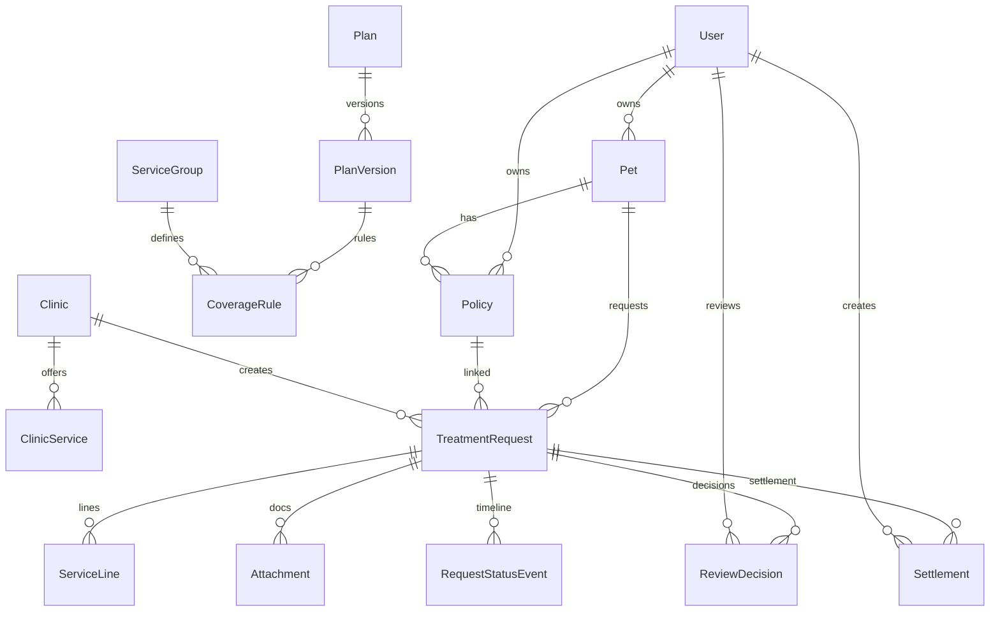

# معماری سامانه — پت‌یار

## پشته فنی
- **Frontend**: Next.js 15 App Router + TypeScript strict, Tailwind CSS v4, Vazirmatn محلی
- **Backend**: Route Handlers `/api/v1`, Service Layer, Prisma ORM
- **DB**: PostgreSQL 17
- **Auth**: JWT HS256 در کوکی HttpOnly/SameSite/Lax, هش scrypt برای رمز
- **Storage**: درایور local خصوصی (قابل تعویض با S3)
- **Tests**: Vitest + Playwright

## لایه‌بندی
```
UI (RSC/CC) → Service (business) → Prisma (data)
                ↑
            API (/api/v1) هم همین سرویس‌ها را صدا می‌کند ⇒ آماده برای Native
```

## موجودیت‌ها
User (OWNER/CLINIC/REVIEWER/ADMIN), Clinic, ServiceGroup, Pet, Plan, PlanVersion, CoverageRule, Policy, TreatmentRequest, ServiceLine, Attachment, ReviewDecision, Settlement (SIMULATED only), AuditEvent, PricingAssumption, PricingRun

## ماشین وضعیت
DRAFT → SUBMITTED → UNDER_REVIEW → (NEEDS_CORRECTION → RESUBMITTED → UNDER_REVIEW) → APPROVED → PENDING_SETTLEMENT → SETTLED_SIMULATED
- رد و اصلاح نیاز به دلیل ≥5 کاراکتر
- APPROVED ≠ پرداخت
- تسویه فقط SIMULATED و فقط از PENDING_SETTLEMENT

## یکای پول
DB: ریال Int, UI: تومان (ریال/10 گرد نیم‌به‌بالا), نرخ‌ها: bps

## تاریخ
DB: timestamptz UTC, UI: شمسی با لایه تبدیل خالص (بدون ICU وابستگی), منطقه: Asia/Tehran

## امنیت
- RBAC سمت سرور برای هر رکورد
- rate-limit در حافظه (۵ ورود/دقیقه)
- فایل خصوصی بدون URL عمومی
- audit trail برای تصمیم/تسویه/تغییر نقش
- IDOR, XSS, CSRF, SQL injection محافظت‌شده via Prisma + validation

## نمودار ERD (Mermaid)

